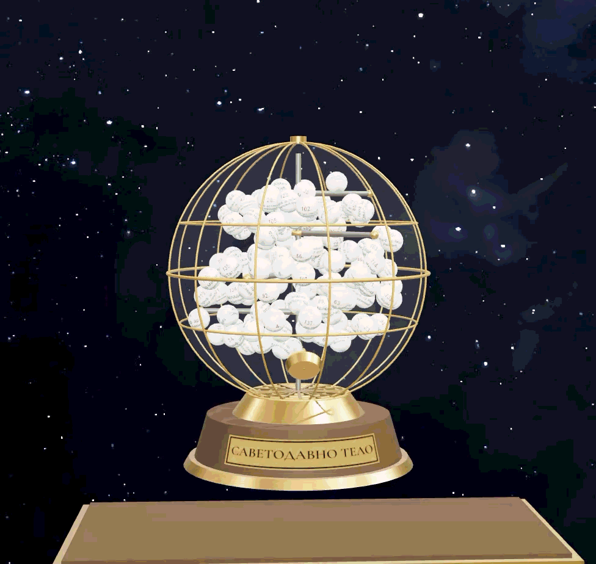

# Саветодавно тело

3Д бубањ за извлачење имена. Налепите списак, пустите лоптице да се врте, и отвор усиса прву која стигне до њега.

3D name-drawing drum. Paste a list, let the balls spin, and the hatch draws whichever ball reaches it first.

Направио [Марко Његомир](https://x.com/njmarko).

## Како се користи

Подразумевани језик је српски ћирилицом. Енглески је на прекидачу у углу.

1. Налепите једно име по реду. Број се дописује сам.
2. Одаберите колико имена да се извуче и колико секунди да се меша пре отварања.
3. **Почни извлачење.** Извучена лоптица пада на подлогу, са конфетама, а име остаје на дну.
4. **Понови извлачење** враћа лоптице у бубањ. **Обриши списак** празни имена.
5. **Извези MP4** снима цело извлачење и коначан списак.

Камера: превлачење окреће, точкић зумира, десни тастер или WASD помера. **Ресетуј камеру** враћа поглед.

У **Физици** су брзина симулације, величина лоптица и апаратуре, шипке, ветар (јачина, ширина, висина), усисавање, гравитација, одскок, отпор и јачина звука удараца.

## Небо

Позадина је текстура звезда и Млечног пута, 8K, [Solar System Scope](https://www.solarsystemscope.com/textures/), [CC BY 4.0](https://creativecommons.org/licenses/by/4.0/).

## Покретање

```bash
npm install
npm run dev
```

Провера: `npm run typecheck` и `npm run build`.
